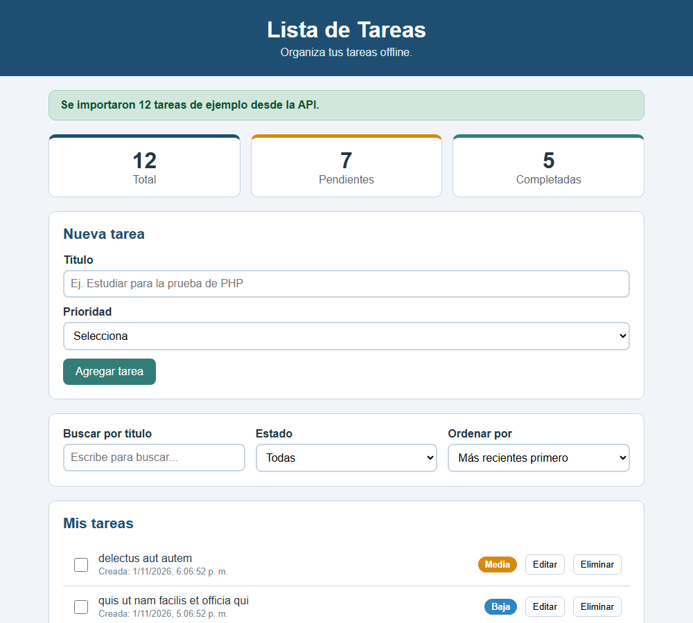

# Lista de Tareas

**Estudiante:** Angel Mauricio Guevara Chinchero  
**Materia:** Programación de Sistemas Web - Universidad ECOTEC  
**Actividad:** Actividad Integradora 2

Aplicación web para gestionar tareas, hecha con HTML, CSS y **JavaScript Vanilla** (sin librerías ni frameworks). Carga tareas de ejemplo desde una API REST, guarda todo en el navegador con `localStorage` y funciona sin conexión a internet.



## Funcionalidades

- **CRUD de tareas:** crear, editar, eliminar y marcar como completadas.
- **Validación:** no permite guardar una tarea con el título vacío (o con menos de 3 caracteres) ni sin prioridad.
- **Búsqueda en tiempo real** por título, letra a letra.
- **Filtros por estado:** Todas, Pendientes y Completadas.
- **Ordenamiento** por fecha de creación (más recientes o más antiguas) o por prioridad (Alta, Media, Baja).
- **Dashboard de métricas:** total de tareas, pendientes y completadas, actualizado con cada cambio.
- **Carga inicial desde la API** [JSONPlaceholder](https://jsonplaceholder.typicode.com/todos) con `fetch` y `async/await`. Solo se importa si `localStorage` está vacío, por lo que no se duplican tareas al recargar.
- **Manejo de errores:** si falla la conexión o el servidor, se muestra un aviso en pantalla y la aplicación sigue funcionando.
- **Persistencia local:** todas las tareas se guardan en `localStorage` con la clave `taskmanager_tareas`.
- **Diseño responsive** para computadora y celular.

## Tecnologías utilizadas

- HTML5
- CSS3 (variables, Flexbox, media queries)
- JavaScript ES6+ (módulos, `fetch`, `async/await`, métodos de arreglos)
- Web Storage API (`localStorage`)
- API REST pública: JSONPlaceholder
- Git y GitHub

## Estructura del proyecto

```
webdev_act_02/
├── index.html          Estructura de la página
├── README.md
├── AI_DECLARATION.md   Declaración de uso de IA
├── css/
│   └── styles.css      Estilos
├── img/
│   └── captura.png     Captura de la aplicación
└── js/
    ├── app.js          Punto de entrada: estado, eventos e inicio
    ├── ui.js           Interfaz visual (DOM)
    ├── tareas.js       Lógica de las tareas (crear, validar, filtrar, ordenar, métricas)
    ├── storage.js      Gestor de localStorage
    └── api.js          Servicio de la API REST
```

## Investigación técnica: Opción A - Arquitectura Modular ES6

El código está dividido en **módulos nativos de JavaScript** (`import` / `export`). Cada archivo tiene una sola responsabilidad:

| Módulo | Responsabilidad |
|---|---|
| `app.js` | Coordina la aplicación: guarda el estado, escucha los eventos e inicia la carga |
| `ui.js` | Todo lo que modifica el DOM (lista, dashboard, notificaciones y formulario) |
| `tareas.js` | Lógica pura: no toca el DOM ni el almacenamiento |
| `storage.js` | Leer y guardar las tareas en `localStorage` con JSON |
| `api.js` | Consultar JSONPlaceholder y convertir los datos al formato de la aplicación |

Solo `app.js` importa a los demás módulos. Para que `ui.js` pueda ejecutar las acciones de los botones sin importar `app.js` (lo que crearía una dependencia circular), `app.js` le pasa un objeto `acciones` con las funciones de completar, editar y eliminar.

## Cómo ejecutar el proyecto

Como usa módulos ES6, **no funciona abriendo `index.html` con doble clic** (el navegador bloquea los módulos con `file://` por la política CORS). Hay que abrirlo con un servidor local:

1. Clonar el repositorio:
   ```
   git clone https://github.com/aguevaranv/webdev_act_02.git
   ```
2. Abrir la carpeta en Visual Studio Code.
3. Instalar la extensión **Live Server**.
4. Hacer clic derecho en `index.html` y elegir **Open with Live Server**.

La primera vez se importan 12 tareas de ejemplo desde la API. Para volver a importarlas: F12 → **Application** → **Local Storage** → borrar la clave `taskmanager_tareas` y recargar la página.
